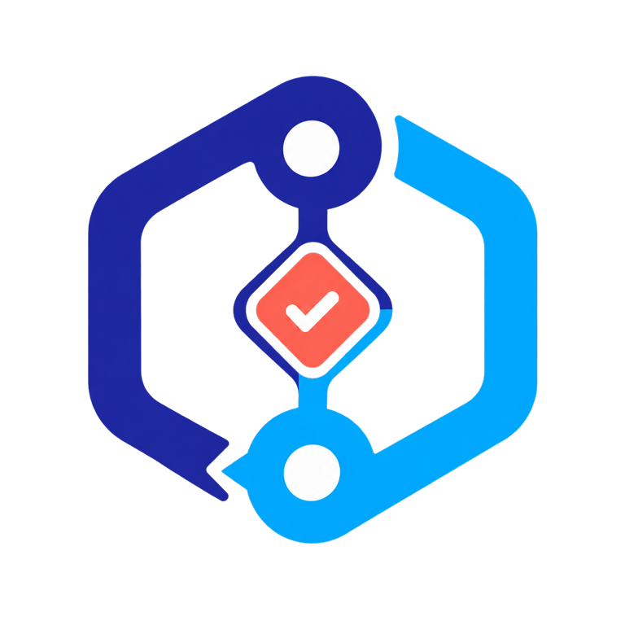

# Scion SDK

<p align="center">
  
</p>

<p align="center">
  <b>Build secure connectors once. Serve, synchronize, and write back through one governed contract.</b><br>
  <sub>The typed source-integration boundary for MCP services and Medulla.</sub>
</p>

[](https://pypi.org/project/scion-sdk/)
[](https://github.com/Knuckles-Team/scion-sdk/actions/workflows/release.yml)
[](https://knuckles-team.github.io/scion-sdk/)
[](https://github.com/Knuckles-Team/scion-sdk/stargazers)
[](https://github.com/Knuckles-Team/scion-sdk/forks)
[](https://github.com/Knuckles-Team/scion-sdk/graphs/contributors)
[](LICENSE)
[](https://github.com/Knuckles-Team/scion-sdk/commits/main)
[](https://github.com/Knuckles-Team/scion-sdk/pulls)
[](https://github.com/Knuckles-Team/scion-sdk/pulls?q=is%3Apr+is%3Aclosed)
[](https://github.com/Knuckles-Team/scion-sdk/issues)
[](https://github.com/Knuckles-Team/scion-sdk)
[](https://github.com/Knuckles-Team/scion-sdk)
[](https://github.com/Knuckles-Team/scion-sdk)
[](https://github.com/Knuckles-Team/scion-sdk)
[](https://pypi.org/project/scion-sdk/)
[](https://pypi.org/project/scion-sdk/)
[](https://pypi.org/project/scion-sdk/)
[](https://pypi.org/project/scion-sdk/)

<p align="center">
  <a href="https://knuckles-team.github.io/scion-sdk/">Documentation</a> ·
  <a href="https://knuckles-team.github.io/scion-sdk/capabilities/">Capabilities</a> ·
  <a href="https://knuckles-team.github.io/scion-sdk/extension-ports/">Interfaces</a> ·
  <a href="https://knuckles-team.github.io/scion-sdk/status/">Status</a>
</p>

---

## Quick Start

Install Scion SDK as `scion-sdk` and import it as
`agent_connector_sdk`. The repository is `scion-sdk`; package, CLI and API
identifiers remain unchanged.

Create a project and install the SDK:

```bash
uv init --bare demo-connector
cd demo-connector
uv add scion-sdk
uv sync
uv run connector-sync --help
```

The command prints the supervised synchronization options without opening a
source session. Continue with the
[connector tutorial](https://knuckles-team.github.io/scion-sdk/tutorial/)
to build and run a one-file MCP connector, observe its health response, add
declarative content, certify the live schema, and join source synchronization.

## Overview

Scion SDK is the ecosystem's source-integration boundary. It turns
vendor APIs and domain tools into secure MCP connectors, transports bounded
source evidence into Medulla, indexes immutable repository snapshots,
and applies authorized changes back to source systems.

Connector packages retain vendor behavior. The SDK owns transport, lifecycle,
certification, and effect execution. Generated Medulla contracts own
durable graph records, checkpoints, content identity, and receipts.

## Key Capabilities

- Build FastMCP servers with authentication, safe exposure, health, visibility,
  rate limits, change subscriptions, and consistent tool surfaces.
- Publish skills, prompts, ontologies, SHACL shapes, and connector manifests as
  typed MCP content.
- Extract bounded source pages and advance checkpoints only from matching
  durable Medulla receipts.
- Import deterministic ConnectorPack archives without copying graph DTOs or
  digest algorithms into connector packages.
- Stream authenticated immutable repository snapshots into the generated
  `IndexRepository` boundary without becoming a semantic writer.
- Govern write-back through dry-run, authorization, source-version checks,
  idempotency, and uncertain-effect reconciliation.
- Certify extension identity, live MCP schemas, pagination, and safety behavior
  before activation.

## Documentation

Start with [Build the operator's first connector](https://knuckles-team.github.io/scion-sdk/tutorial/),
then choose the reference that matches the work:

- [Documentation home](https://knuckles-team.github.io/scion-sdk/)
- [Capabilities](https://knuckles-team.github.io/scion-sdk/capabilities/)
- [Architecture](https://knuckles-team.github.io/scion-sdk/architecture/)
- [Connector servers](https://knuckles-team.github.io/scion-sdk/connector-servers/)
- [Schema disclosure](https://knuckles-team.github.io/scion-sdk/schema-disclosure/)
- [Source synchronization](https://knuckles-team.github.io/scion-sdk/connector-sync/)
- [Repository ingestion](https://knuckles-team.github.io/scion-sdk/repository-ingestion/)
- [Extension interfaces](https://knuckles-team.github.io/scion-sdk/extension-ports/)
- [Current status](https://knuckles-team.github.io/scion-sdk/status/)

Sibling authorities: [Medulla](https://knuckles-team.github.io/medulla/)
owns durable graph state and generated contracts; [Arbora](https://knuckles-team.github.io/arbora/)
owns authenticated runtime composition.

## Architecture

[](https://knuckles-team.github.io/.github/architecture/#sdk)

[Explore the live architecture](https://knuckles-team.github.io/.github/architecture/#sdk)

| Boundary | Owned here | Owned elsewhere |
|---|---|---|
| Connector service | MCP lifecycle, exposure policy, content capture, certification | Vendor models and business semantics stay in the connector package. |
| Source ingest | Discovery, bounded extraction, transport, receipt verification | Medulla owns mapping, checkpoints, provenance, and commit receipts. |
| Repository ingest | Authenticated snapshots, stable manifests, bounded object transport | Medulla owns indexing, graph projection, and semantic interpretation. |
| Write-back | Preview, source-version checks, apply, and reconciliation | Medulla owns change sets, authorization decisions, and durable outcomes. |
| Runtime composition | Typed ports and checked dependency requirements | Arbora supplies authenticated identity, clients, and live authority. |

The SDK depends directly on `epistemic-graph>=2.27.6`. Generated SourceIngest,
ConnectorPack, IndexRepository, and WriteBack clients and models are the graph
boundary; the SDK adds no parallel graph contract.

## Contributing

Issues and pull requests are welcome. Follow [AGENTS.md](AGENTS.md) for ownership,
isolation, and validation rules, and run the affected tests and public-surface
gates before submitting a change.

## License

Scion SDK is released under the [MIT License](LICENSE).
