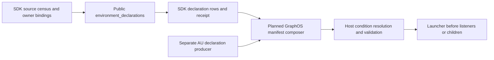
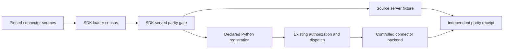

# Implementation design: connector control

1. Freeze the public manifest and generated graph-client boundary. List every existing SDK extension point and remove duplicate representations instead of creating aliases.
2. Complete canonical input/output schema fingerprints, package tuple certification, annotation validation, and deterministic pack idempotency in current `manifest/`, `certify/`, and `artifacts/` modules.
3. Keep server factory, auth, HTTP, TLS, credentials, visibility, and action dispatch behind SDK APIs. Migrate connector packages in the five named batches with one synthetic public fixture first; re-target package templates to those APIs.
4. Replace legacy source and connector toolkit imports at consumer boundaries. Remove old toolkit only after import scans and independent package tests pass. Preserve vendor behavior in each connector, not the SDK.
5. Lock the published graph-client wheel, build the SDK wheel, run offline unit/conformance checks. Then run an opt-in environment-backed pack publication and retry probe. Record commit, wheel digest, and redacted receipt in `spec.md`.

Each slice is mergeable with its own conformance tests. No step requires a live home deployment for ordinary pull-request validation.

## Prompt capture fallback (SDK-CONNECTOR-CONTROL-R024)

`transports/mcp_session.py` gains `McpPromptRejectedError(McpTransportError)`, raised from
`McpClientSession.get_prompt` only when the underlying failure is `mcp.shared.exceptions.MCPError`
-- a well-formed protocol error the server returned, as opposed to a transport-level failure
(timeout, dropped connection, malformed response) which keeps raising the existing
`McpTransportError`. `artifacts/prompts.py` already imports from `transports/mcp.py`'s sibling
module through `artifacts/pack.py`, so `artifacts/prompts.py` importing `McpPromptRejectedError`
from `transports/mcp_session.py` keeps the same dependency direction. `PromptArtifactKind.list_entries`
catches that one error type around `session.get_prompt`, and only when the prompt bound at least
one required argument; it then builds the entry from a synthesized `GetPromptResult` listing the
prompt's own argument names, never from server content. No change to `_capture_metadata`,
`_validate_contract`, or `validate` is needed: `capture.kind` already depends only on whether an
argument is required. It does not depend on how the result was obtained.

## Cross-repo prerequisites (SDK-CONNECTOR-CONTROL-R037 to R044)

Operation contracts for erpnext, uptime and container-manager are recorded as `access_contracts.ttl` plus a fixture. The engine's virtual mappings read equal rows. The five access kinds (MCP, A2A, REST, GraphQL, virtual-graph) are declared by `ACCESS_KINDS`; only `virtual_graph` is new. The engine reads sources at query time and never copies them.

## Tool contract facts (SDK-CONNECTOR-CONTROL-R045)

Data flow: tool declaration (`eg.annotations` in `_meta`, or MCP `ToolAnnotations`) → `_annotations_from_mcp` (`agent_connector_sdk/artifacts/annotations.py:94`) → `ToolContractFacts` builder → `_tool_entry` (`agent_connector_sdk/artifacts/tools.py:34`) → `build_content_pack` (`agent_connector_sdk/artifacts/pack.py:127`) → `ConnectorPackClient` (R001) → engine tool-subset decision and the agent-utilities run loop.

Types and fields. `ToolContractFacts` holds `read_only` (boolean), `side_effects` (closed set `none`, `workspace_write`, `external_write`, `network`), `arg_schema`, `schema_tokens` and `declared_by` (`connector`, `mcp_hint`, `default`). The engine and the run loop read these names. They define no second spelling.

Attach point. `_tool_entry` already builds the canonical body and the annotations in one place (`tools.py:38`, `tools.py:47`). The facts builder runs there. The manifest side attaches at `write_certified_pins` (`agent_connector_sdk/certify/pins.py:111`). The generator renders `connector_manifest.yml`. No person edits that file.

Failure and refusal. An undeclared tool gets `read_only = false` and `side_effects = {external_write}` with `declared_by = default`. A contradictory declaration (read-only with a write effect) raises `MalformedArtifactError`. A self-declared `read_only` without a fixture yields the `unproven` verdict and no pin. A fixture that records a write yields the `read_only_violation` verdict.

Reuse. `_TOOL_HINTS` (`annotations.py:15`) maps `readOnlyHint`, `destructiveHint` and `idempotentHint` already. `is_destructive_action` (`agent_connector_sdk/mcp/action_dispatch.py:88`) classifies destructive operations. `canonical_json` and `canonical_input_schema` supply the body that `schema_tokens` measures. No token size exists in the SDK today, so `schema_tokens` is new. `_TOOL_HINTS` also drops `read_only_hint` into the generated `PackAnnotations`, which lacks `side_effects` and `schema_tokens`. The generated type is new work in the engine.

New. `ToolContractFacts`, `SideEffect`, `schema_tokens`, `ToolFixture`, `check_read_only`, and the manifest rendering. The SDK records no fixtures today (`certify_connector`, `certification.py:75`, compares pins only). R045.9 therefore creates the fixture type before the check.

Decisions.

- The safe default is `read_only = false`. The rejected alternative infers `read_only` from a `get_` or `list_` name. A name guess can mark a writer as safe.
- An MCP hint is recorded as self-declared and needs a fixture. The rejected alternative trusts the server. Annotations are hints, not proof.
- The SDK computes `schema_tokens` once. The rejected alternative lets each consumer estimate size. That gives the engine and the run loop different numbers.
- The estimator divisor is a named default. A measured tokenizer count may replace it.

Cross-repository rows. Depends on the `EG-TYPED-PACKS` row that adds `side_effects` and `schema_tokens` to the generated `PackAnnotations`. Unblocks the `EG-DECISION-ENGINE` tool-subset rows that read `read_only` and `schema_tokens` for the `HarnessConfig` allowed tool subset. Unblocks the `AU-HARNESS` run-guard row that runs read-only tools in parallel and reads the same envelope subset.

## Scoped credentials and bounded PKCE (SDK-CONNECTOR-CONTROL-R035, R046)

Data flow: authenticated connector request -> qualified host grant -> SDK credential/PKCE transport -> approved vault receipt -> authorized provider call.
GRAPHOS-IDENTITY-R023.1 through R023.6 owns scoped broker reuse, challenge lifecycle and persistence.
EG remains the decision and durable grant authority. The SDK validates injected binding facts; it creates no local approval or token database.
The exact binding includes tenant, owner principal, requesting principal/client, connector, provider, audience, scope set, resource and operation.
Compare each field against qualified request authority and the current grant before resolving either environment or vault references.
The authority port is injected by trusted host composition, not supplied as request JSON or inferred from host/process identity.
`CredentialProvider.get_secret` at `agent_connector_sdk/credentials/provider.py:33` currently scopes vault paths by connector and treats environment references as process-wide.
It lacks tenant/client reuse grants. Extend that boundary; retain the existing credential resolver.
The existing `resolve_secret_reference` at `agent_connector_sdk/credentials/resolution.py:43` remains the underlying resolution path.
Missing qualified authority yields `authority_unavailable`; missing usable credentials yields `credential_unavailable`.
Map `scope_denied` and `binding_mismatch` to host `reuse_denied`. Map `grant_expired` to expired; preserve revoked and unavailable dependency distinctions.
Never return resolved values to an agent transcript or public tool result. Inject them only into the approved transport's transient memory.

Missing credentials may invoke the one reusable PkceAuthManager only through an admitted host interaction policy.
The host owns pending operation identity, scoped single-flight, one-use state and vault persistence; SDK handles PKCE and bounded transport mechanics.
Consume the same broker challenge reference throughout browser opening, callback, exchange, persistence and continuation.
Do not create a second challenge authority or duplicate broker store. The host adapter is an explicit missing integration dependency.
Use the declared 64-character random verifier, S256 challenge and 120-second total deadline; a host may shorten the deadline.
Every awaited phase receives the remaining time. Browser opening failure returns `browser_launch_failed`; listener failure returns `callback_unavailable`.
No input channel returns `interaction_required` immediately; an available channel that times out returns `input_timeout`.
Headless input is an authenticated response containing the complete redirect result and state. Bind it to the original caller/client and challenge.
Never accept an unbound pasted code, a process-global code file or indefinite stdin polling.
Cancellation, expiry and replay invalidate state and stop listeners; cross-client input cannot resume another request.
Before exchange, validate state, client binding, redirect and the approved issuer/token endpoint configuration.
After exchange, apply the declared provider token profile below before persistence.
JWT/OIDC verification and opaque-token binding use distinct validation methods; neither may fall back to the other.
PKCE proves possession during exchange; it does not grant resource or credential reuse authority.
Readiness requires a confirmed host vault persistence receipt and fresh grant. Failed or ambiguous persistence never resumes the operation.
Refresh and restart use host-owned vault versioning and current grants; the SDK has no independent token cache authority.
Static-token connectors retain their mode but still require the scoped credential boundary when hosted for multiple callers.

The actual certify call site is `agent_connector_sdk/certify/cli.py:124` invoking _oidc_auth at `agent_connector_sdk/certify/options.py:26`.
_run_certification at cli.py:169 drives the existing command. _oidc_auth currently returns client-credentials authentication only.
The previous `build_outbound_auth` reference names no production function. Add the PKCE selection to the real options composition.
Register connector credential-missing handling through `register_tool_surface` at `agent_connector_sdk/mcp/tool_surface.py:121` and existing `dispatch_async`.
Reuse governed HTTP, endpoint validation and credential references. PkceAuthManager and its host ports remain unimplemented.
For `no_credential`, the host projects `credential_missing`; preserve the shared challenge error names unchanged.
All new R035 children and the refined R046 children require real local issuer/callback and served connector evidence.
No arXiv derivation is claimed for this protocol contract.

## Agent-card discovery (SDK-CONNECTOR-CONTROL-R047)

Data flow: `extract` (`agent_connector_sdk/vendor_extractors/a2a.py:98`) -> `_collect_cards` (`agent_connector_sdk/vendor_extractors/a2a_helpers.py:79`) -> `discover_agent_card` (new) -> governed HTTP client -> `A2AAgentCard` entity with provenance.

Types. `DiscoveredAgentCard` and `AgentCardRefused` are new. The entity shape is the existing one from `_card_entity` (`agent_connector_sdk/vendor_extractors/a2a.py:34`) plus three provenance fields.

Attach point and caller. `_collect_cards` is called by `extract`, which the vendor extractor registry runs.

Failure behavior. A refusal skips that agent and reports the reason. The remaining cards still enter the change set.

Reused: `create_http_client` (`agent_connector_sdk/http/client.py:84`) supplies the egress policy. New: the fetch, the etag cache and the provenance fields.

Decision. Discovery is a pull at extractor time. The rejected alternative is a push registry that each agent must call. That fails for agents that do not know the platform.

Cross-repository rows. The delegation rule that decides when to invoke an agent belongs to the harness owner (`AU-` prefix). It reads the recorded card by entity type `A2AAgentCard`.

## Agent-readable tool output (SDK-CONNECTOR-CONTROL-R048)

Data flow: certify command run loop -> `certify_connector` (`agent_connector_sdk/certify/certification.py:75`) -> `check_readable_form` (new) -> verdict; and `ToolArtifactKind.list_entries` (`agent_connector_sdk/artifacts/tools.py:64`) -> `_tool_entry` (`agent_connector_sdk/artifacts/tools.py:25`) -> pack annotations.

Types. `ReadableForm` is new and extends `ToolContractFacts`. The question set is a list of question and expected-answer pairs held in a fixture file.

Attach point and caller. `_tool_entry` is called by `list_entries`, which `build_content_pack` runs.

Failure behavior. A missing question set refuses certification. A score below the named threshold of 0.8 is reported, not hidden.

Reused: `canonical_json` body building in `_tool_entry`. New: the form, the renderer and the scorer.

Decision. The score is the fraction of graded questions answered from the text form. The rejected alternative is a free-form model judgment, which cannot be replayed offline.

Cross-repository rows. The engine's tool-subset decision (`EG-DECISION-ENGINE`) may read `score` through the generated pack annotation; that field needs the `EG-TYPED-PACKS` row first.

References
- arXiv:2605.03808 — Singh et al., "Agentic-imodels: Evolving agentic interpretability tools via autoresearch" (2026)

## Payment challenge handling (SDK-CONNECTOR-CONTROL-R049)

Data flow: served operation -> governed client from `create_http_client` (`agent_connector_sdk/http/client.py:84`) -> 402 response hook -> `PaymentGate.decide` (new) -> `ctx_confirm_destructive` (`agent_connector_sdk/mcp/context.py:49`) -> retry with payment header -> `PaymentRecord` entity.

Types. `PaymentChallenge`, `PaymentBudget`, `PaymentRecord` and `PaymentRefused` are new.

Attach point and caller. The hook attaches inside `create_http_client`. Connector operations that build a client reach it without change.

Failure behavior. Every refusal returns the original 402 response to the caller, with no payment header sent.

Reused: the approval prompt in `ctx_confirm_destructive` and the egress policy in the same client. New: the gate, the budget and the record.

Decision. Zero budget by default and approval on every payment. The rejected alternative is a standing allowance, which lets a prompt-injected request spend without a person deciding.

Cross-repository rows. The graph node type for a transaction belongs to the knowledge-graph owner (`EG-` prefix). The SDK emits the entity; its owner maps it.

## Caller-scoped context and progress (SDK-CONNECTOR-CONTROL-R050)

Data flow: served `tools/call` -> registered tool -> authenticated context binding ->
`dispatch_async` -> connector method -> ordered notifications -> terminal result.

Existing code: `create_mcp_server` in `agent_connector_sdk/mcp/server.py:88`
builds the served MCP boundary. `_register_condensed` in
`agent_connector_sdk/mcp/tool_surface.py:97` invokes connector registrars.
`_build_tool` in `agent_connector_sdk/mcp/method_tools.py:133` receives a context
and calls the client method. `dispatch_async` in
`agent_connector_sdk/mcp/action_dispatch.py:194` guards destructive actions.
`ctx_confirm_destructive` in `agent_connector_sdk/mcp/context.py:49` denies
missing context; `ctx_log` at line 71 forwards client logs.

Reachable today: no. Registration, dispatch, logging and elicitation are reachable.
The shared typed context, ordered progress sender and terminal metadata are missing.
The direct method wrapper does not forward context to its client method.
Condensed registrars do not enforce context delivery to every handler.

Reuse the existing registration and dispatch paths. Add request binding at server
invocation and validate context support during registration. Registration must refuse
a tool that cannot receive context. Keep transport context out of the public tool
argument schema. Bind identity from authenticated server state, never tool arguments.
The method wrapper must use the same context adapter as condensed handlers.
The adapter passes context only through a declared typed parameter.

`request_cache` keys include tenant, actor, connector, operation, normalized argument
digest and authorization scope. The cache holds typed transient values only.
Clear it on terminal completion, cancellation or deadline. Never cache approvals,
credentials or effect results. Cross-request reuse requires the existing owning
service; this context creates no knowledge store or workflow memory.

`ordered_progress` assigns sequence numbers under one per-request asynchronous lock.
Emitted completion values must be finite and strictly increase, including when total is unknown.
Under the same lock, suppress equal completion notifications and refuse decreases.
Internal terminal summaries may update separately; never invent progress increments for message changes.
A total, once set, cannot change.
UTF-8 messages are capped at 4096 bytes and redacted before transport.
`bounded_delivery` permits one outstanding send per request and a five-second send
deadline, capped by the remaining request deadline. These named limits are configurable.
Backpressure awaits the send; it creates no unbounded queue. No notification follows
a terminal result. With no token, update the terminal summary without sending.
Cancellation stops new work and records any already-started effect as uncertain.

EG owns the approval decision; GraphOS authenticates its exchange and returns the decision unchanged.
The SDK checks its binding to tenant, actor, operation, argument digest and expiry.
Interactive elicitation is an input to that decision;
a truthy payload is not authorization. Reuse the governed write-back adapter for
source mutations, reservation, deterministic idempotency and restart recovery.
Transport retry never retries an effect blindly. A duplicate request with the same
bound effect key resolves through its durable receipt. Changed arguments under that
key refuse. Progress delivery is not a durable event log and is not replayed after reconnect.
Reconnect result retrieval has an explicit producer requirement gap.
EG must own a durable mapping from the stable request identity to the terminal result and effect receipts.
GraphOS must serve an authenticated read of that mapping.
The mapping must bind tenant, actor, connector, operation, argument digest, change-set ID and effect idempotency key.
No established producer operation or SDK adapter for that mapping is identified here.
`GRAPHOS-A2A-R006` defines invocation and confirmation, not result retrieval.
Until those producer requirements and their SDK binding exist, reconnect recovery must return `recovery_unavailable`.
It must not synthesize a result, reconstruct one from transient progress or repeat a source effect.

Existing effect recovery is narrower: `EpistemicGraphWriteBackLedger.get` and `receipts`
in `agent_connector_sdk/writeback/epistemic_graph.py:43` and line 73 read generated EG records.
`DurableWritableConnector.apply` at `agent_connector_sdk/writeback/connector.py:75`
uses those records to prevent repeated effects. Its `reconcile` method at line 96
records a reconciliation observation. These methods do not map an MCP request to its terminal result.
Keep governed effect recovery; do not present it as served reconnect result retrieval.

Decision: attach context to the existing served call and dispatch boundary.
Rejected alternative: a separate progress service and effect retry queue, which
creates another authority for call state and mutation outcomes.

Cross-repository rows: `GRAPHOS-A2A-R005.4` serves EG's admission verdict unchanged;
`GRAPHOS-A2A-R006` owns invocation and confirmation. `EG-ORCH-VOCAB-R013` owns durable trace
records. `SDK-GOVERNED-WRITEBACK-R004` owns approval-bound effect idempotency.
Consumers: AU runs the received action; WebUI renders received progress.
Neither consumer selects connector routes or creates approval decisions here.

References: this contract derives from connector context and MCP progress needs.
No research-paper claim or benchmark is needed for these two source candidates.
The [MCP progress specification](https://modelcontextprotocol.io/specification/2025-06-18/basic/utilities/progress)
requires each notification's progress value to increase, even without a known total.

## Connector-bound grants and provider token profiles

This shared contract refines GRAPHOS-IDENTITY-R023 and SDK-CONNECTOR-CONTROL-R035/R046. Implementation still needs the required runtime wiring.
The exact credential-use tuple includes tenant, owner principal, requesting principal/client, connector, provider, audience, scopes, resource and operation.
The host derives connector from authenticated admission and the certified target connector registration, with its immutable registry revision.
A caller's connector ID is only a requested target; it cannot populate the trusted binding or current grant.
Compare the admitted connector with the grant, challenge, vault ownership tuple and SDK transport before any secret resolution or exchange.
Missing, forged or mismatched connector identity yields SDK `binding_mismatch` and host `reuse_denied`, with no credential or provider activity.
Changing connector requires a matching new grant, even when principal, client, tenant, provider and scopes remain identical.

ProviderTokenProfile is trusted configuration pinned by profile ID and revision in the grant and ceremony.
It declares issuer/provider authority, client, permitted resource audiences, consent scope ceiling and separate ID/access/refresh token representations.
Representations are jwt or opaque. OIDC ID tokens require jwt; access and refresh tokens may use either declared representation.
The profile also declares required validation fields, opaque binding mode, trusted introspection endpoint and validity/reuse bounds.
Never infer representation from token punctuation, client input or an unsuccessful signature verification. An unknown profile refuses without fallback.

For JWT tokens, validate the allowed algorithm, trusted signature key, issuer and token-role-specific audience and validity claims.
An OIDC ID token binds the client audience and ceremony nonce; access-token audiences bind approved resources.
Require the profile's claims, including expiry for JWT/OIDC; reject missing claims, wrong issuer/audience, bad signature, expiry or nonce mismatch.
Validate any provider tenant/account/consent claims against the established binding when the profile requires or returns them.
An ID token proves identity; it is not an access token and cannot be injected into a provider API request.

For opaque tokens, trust only an authenticated exchange with the configured provider endpoint under the bound client and PKCE ceremony.
Record the provider response's authenticated account, granted scope and validity metadata. Never decode opaque bytes or invent issuer/signature/expiry claims.
The profile selects `exchange_bound` or `introspection_required`. Its binding policy must establish the required account, audience/resource and consent evidence.
Exchange-bound evidence comes from the admitted authorization request and authenticated provider response under the declared provider contract.
If that contract cannot establish a required binding, refuse; successful transport alone is insufficient.
Required introspection uses the configured trusted endpoint and authenticated client, requires active=true and validates all declared binding fields.
Inactive, contradictory or missing required introspection evidence refuses. Unavailable required introspection never falls back to exchange-only acceptance.
Use provider expiry metadata when available. Otherwise apply a bounded host use lease; never describe that lease as provider token expiry.
No reuse outlives the current grant or profile validity policy. Refresh tokens go only to the bound provider token endpoint.
Refresh preserves connector, issuer/provider, client, tenant, account, audience and consent ceilings; any required missing evidence refuses.

Host tenant and requesting identity always come from authenticated admission and EG authority, including for opaque provider tokens.
This profile applies to outbound provider credentials only. GRAPHOS-IDENTITY-R017 API bearer admission still requires its signed tenant claim.
The broker stores profile revision, validation method, binding digest and provenance for validity metadata alongside the vault receipt.
Opaque exchange metadata and host lease bounds remain distinct from signed JWT claims in evidence and logs.
Map profile errors to `invalid_token_profile` or `token_validation_failed`; required introspection failures use `introspection_unavailable` or `token_inactive`.
These shared typed refusals stop persistence readiness and operation continuation; no token, code or raw introspection body enters public output.

## Amendments

### 2026-10-12: native status and packaged resources (SDK-CONNECTOR-CONTROL-R005)

The server factory registers the exact operational resource `connector://status`.
`ResourceArtifactKind.list_entries` excludes that endpoint before reading packaged content.
The capability resource remains a template, outside `resources/list`; capture does not list template instances.
No other `connector://` resource is exempt. Unknown schemes and malformed packaged bodies still fail validation.
The existing generated archive builder remains the sole archive and hash implementation.
`tests/test_mcp_native_primitives.py` exercises actual factory registration, transport, packaged content capture and unknown-resource refusal.

<!-- spec-definition-patch:sdk5-r007-major-version-plan -->
## SDK:5 - major-version compatibility gate (R007.1-R007.6)

### Existing attachment and missing dependency

`scan_many_packages` and `PackageScanResult` currently report Python import-scan findings. They do not test target-major compatibility, produce receipts, or gate pin writes. No fleet-upgrade command or dependency-pin gate exists. R009-R013 track five package batches. Their manifests and lockfiles lack one shared SDK gate. The producer, authorization, rollout entry point, and per-package pre-write attachments remain missing.

### Required dependency order

1. Resolve the complete package inventory and transition inputs. Bind each package to its repository, source commit, current pin, and dependency-file preimage. Bind the target major and immutable artifact digest. Canonicalize entries and hash the inventory. Stop if completeness is unknown.
2. Define the transition, inventory, receipt, and gate models under R007.1. Evaluate every package against the target artifact in isolation under R007.2. Do not change tracked pin files. Record one complete receipt per package.
3. Implement fleet authorization under R007.3. Check exact receipt membership and bound inputs. Refuse missing, duplicate, extra, failed, incomplete, cancelled, stale, or mismatched receipts.
4. Attach fleet preflight before the first pin write. Recheck each package authorization and preimage before its writer's first write. Require both checks in R009-R013. Incompatible, missing, or stale preflight receipts block all writes and preserve all pins. A later package race refuses that package's write. Report applied/refused packages and reconciliation_required. Align with `PIPE-RELEASE-R001.8` through `PIPE-RELEASE-R001.12`. Do not imply rollback of earlier writes.
5. Record credential-free transition, inventory, receipt, suite, and consumed authorization evidence under R007.5. Record each writer outcome and any partial/reconciliation state. Preserve fingerprint, live-contract, and migration acceptance.
6. Prove passing and preflight-refusal flows through the real rollout entry point. Also test a writer-B preimage race after writer A commits. Assert B has no write and the result requires reconciliation. Do not assert rollback of A. Keep the plan blocked until producer and consumer attachments work.

### Acceptance dependencies

R007.1 precedes R007.2; R007.2 precedes R007.3. R007.3 and R007.4 precede R007.6. R007.5 records their bound inputs and decisions. R007.3 precedes each R009-R013 package-pin migration. Preserve their existing migration and import-scan requirements. This plan claims no completed migration or runtime evidence.
<!-- /spec-definition-patch -->

<!-- spec-definition-patch:sdk-consolidated-primary-20261012-plan -->
## Consolidated SDK owner definitions

### SDK-CONNECTOR-CONTROL-R051
1. SDK-CONNECTOR-CONTROL-R051.1: Define SandboxProvisioner. It consumes GraphOS ProvisionRequest. It returns ProvisionResult with allocation ID, actual instances, observed image/platform, state, timestamps, and provider receipt.
2. SDK-CONNECTOR-CONTROL-R051.2: Allocate once per stable operation ID. Reconcile uncertain results before retry. Transport loss never proves no allocation.
3. SDK-CONNECTOR-CONTROL-R051.3: Plan agent_connector_sdk.ports.sandbox.SandboxProvisioner. Route AU sandbox access through GraphOS agents.run and NativeWorkItemAdmissionProtocol/CapacityLedger. Call the SDK adapter, then return its receipt to GraphOS. This producer and binding are absent.
4. SDK-CONNECTOR-CONTROL-R051.4: Refuse unsupported profiles, missing grants, expired requests, and conflicting replay IDs before provider calls. Reconcile unresolved outcomes before retry. Unsupported combinations allocate nothing.
5. SDK-CONNECTOR-CONTROL-R051.5: Bind request/result digests, adapter version, matrix revision, operation/allocation IDs, instances, state, timestamps, and reconciliation. Exclude credentials and secret values.
6. SDK-CONNECTOR-CONTROL-R051.6: Future served tests enter GraphOS agents.run. Use a disposable certified adapter. Observe instances and independent readback. Test unsupported profiles and response loss without duplicates.

### SDK-CONNECTOR-CONTROL-R052
1. SDK-CONNECTOR-CONTROL-R052.1: Define VisualObservationEnvelope. Include observation ID, modality, source operation, and frame or sequence. Bind capture time, content digest/reference, tenant/run/request scope, and schema revision. Keep payload behind governed references.
2. SDK-CONNECTOR-CONTROL-R052.2: Pass ordered observation references to the next authorized step in the same run. EG owns durable storage and retention. SDK request_cache is not cross-request memory.
3. SDK-CONNECTOR-CONTROL-R052.3: Bind create_mcp_server tools/call through tool_surface or method_tools and dispatch_async. Forward the observation to EG state, then AU. The current SDK path lacks this producer and binding.
4. SDK-CONNECTOR-CONTROL-R052.4: Refuse expired, invalidated, uncommitted, unauthorized, cross-tenant/run, and wrong-schema references before provider calls. Never substitute another request's cache.
5. SDK-CONNECTOR-CONTROL-R052.5: Bind the digest, source/frame, producer operation, tenant/run, schema revision, retention decision, and consumer step. Exclude raw visual content and secrets.
6. SDK-CONNECTOR-CONTROL-R052.6: Future served tests cross MCP tools/call, EG state write/readback, and AU next-step use. Prove same-run reuse, cross-run isolation, and stale-reference refusal.

### SDK-CONNECTOR-CONTROL-R053

Component: SDK environment declaration producer

Depends-on: SDK-CONNECTOR-CONTROL-R016, SDK-CONNECTOR-CONTROL-R029, [GraphOS host contract](https://github.com/Knuckles-Team/graph-os/blob/7af96428d92ffbdd963515f7b129d1ad4132e462/specs/host-composition-boundary/spec.md)

Code: ../../agent_connector_sdk/config.py:35

Code: ../../agent_connector_sdk/config.py:75

Code: ../../agent_connector_sdk/credentials/resolver.py:36

Code: ../../agent_connector_sdk/mcp/tool_surface.py:102

Code: ../../agent_connector_sdk/config_git.py:8

Implement environment_declarations(*, source_revision, dynamic_bindings=()) in the existing public config module.
Return EnvironmentDeclarationExport with the immutable declarations tuple and EnvironmentDeclarationReceipt.
An available export requires receipt outcome available and an empty unresolved_call_sites list.
On refusal, raise EnvironmentDeclarationError carrying a refused receipt and no declaration fragment.
Use null for unavailable revisions or digests; never substitute empty-set digests.
This result is a public SDK transport container, not a replacement host manifest.
GraphOS must wrap those exact row fields under its schema_version and declarations keys.
Its R010.2 composer must call this export before R010.3 startup validation and R010.4 conditional resolution.
The planned host implementation must import the public config module, never SDK private configuration internals.
The export and host composer are absent today; implementation acceptance remains pending.

EnvironmentReadBinding must identify a source call site, owning distribution and exact input name.
It must reference the owner's declared condition, type, default and sensitivity constraints.
Resolve conditions using the host contract's typed condition representation; never evaluate expression strings or environment values in the export.
If that representation cannot express an owner condition, return an unsupported-condition refusal and retain the producer dependency.
Do not infer requiredness or secret status from the current process environment.
Validate the supplied immutable source revision against the pinned package artifact used by the fixture or composition root.

Build the census from all tracked SDK Python files and declared dependency read paths.
Record path, line, source digest, accessor form and resolved literal or explicit dynamic binding.
Classify the implementation of setting as an accessor whose callers must all be bound.
Do not count its generic key argument as an independent declaration or ignore unbound callers.
The config and visibility readers are only part of this census.
Include runner, server, parser, registry, auth, credential, ingest, TLS and privacy readers.
Dynamic families include library_state's base_setting, tool_surface's derived tag name, network_inputs' setting_name and credential env-reference targets.
TLS prefix/suffix combinations also require explicit owner bindings.
config_git forwards an inherited environment after filtering Git selectors.
That forwarding is not a declaration producer; bind its downstream consumers or keep the forwarding edge unresolved.
An unreadable file, unresolved alias, indirect read or unclassified call site must block a complete export.

Deduplicate names only when types, defaults, sensitivity and required conditions agree.
Combine sorted call_sites for compatible declarations; a conflict must return a typed refusal.
Safe static defaults belong in declarations because the host schema requires them.
Live values, sensitive defaults and resolved credential references never belong in the export or its receipt.
Preserve existing setting coercion and precedence while the host performs stricter startup validation.

Implement the six R053 children in order: model, census behavior, public export wiring, refusal, evidence and served proof.
Use seed 53 for deterministic valid, missing, malformed, dynamic and disabled-component fixtures.
The real host fixture must import the SDK operation and observe actual listener and child-process counts.
SDK-only census checks cannot substitute for host launcher acceptance or claim AU producer completeness.

### JSON tag-loader migration

Component: Connector registration
Depends-on: SDK-CONNECTOR-CONTROL-R020, SDK-CONNECTOR-CONTROL-R026, SDK-CONNECTOR-CONTROL-R026.1, SDK-CONNECTOR-CONTROL-R032

Code: ../../agent_connector_sdk/testing/fleet_migration.py:90

Code: ../../agent_connector_sdk/mcp/server.py:88

Code: ../../agent_connector_sdk/mcp/tool_surface.py:121

Code: ../../agent_connector_sdk/mcp/method_tools.py:157

Code: ../../agent_connector_sdk/mcp/action_dispatch.py:196

Existing code: `scan_many_packages` supplies the import scan. It does not list JSON registration loaders.
Existing registration and dispatch functions own both supported surfaces.
Reachable today: no complete loader inventory or served comparison gate exists.

The SDK must extend fleet_migration with JsonTagLoaderEntry and the deterministic census described by R054.1 and R054.2.
The caller must supply an explicit package set with immutable revisions and declared startup entrypoints.
Scan all tracked Python and JSON package assets, without excluding unreadable or dynamically resolved registration paths as clean.
An unresolved path blocks the gate until its explicit loader binding joins the inventory.
Inventory completion means every discovered loader and source operation has exactly one recorded disposition and target.
Each operation_mappings entry pairs source_operation_id with target_operation_id and target_registration.
Bind the paired schemas, tags, authorization references and refusals to that entry and include it in the inventory digest.
Use the existing schema normalization contract under R002 and R003 for comparisons.
Preserve array order where schemas define ordered tuples; do not erase meaningful schema differences.

The gate starts source and replacement servers in separate controlled fixtures through create_mcp_server.
Each fixture must use the same admitted principal, synthetic backend state, protocol and operation inputs.
An MCP client lists the served catalogs and calls every mapped operation through registration, authorization and dispatch.
Independent backend observations prove call counts and results.
Each connector owns its fixture and migration commit; the SDK owns the reusable gate and receipt format.
Missing fixtures or unavailable legacy transport block completion instead of producing passing empty comparisons.

Decision: R020 removes implicit mode selection, while R026 and R032 retain explicit registration opt-ins.
The existing verbose_register callback follows condensed registration; register_method_tools remains the per-method primitive.
Reject a blanket ban on explicit callbacks because it contradicts R026/R032 and removes supported connector behavior.
Do not change R026.1 confirmation or its producer dependencies.

R054.1 defines the model. R054.2 classifies the complete inventory before R054.3 wires the served gate.
R054.4 supplies refusal cases; R054.5 binds reconstructable evidence; R054.6 proves the complete served matrix.
The acceptance test names in test-spec.md are planned paths, not existing runtime receipts.

Within each family, Model precedes Behavior and Wiring. Refusal and Evidence bind the same operation. Hot-path proof depends on all prior children.
<!-- /spec-definition-patch -->

<!-- spec-definition-patch:sdk-confirmation-r026-1 -->
### SDK-CONNECTOR-CONTROL-R026.1 — negotiated destructive confirmation

Bind confirmation to the live MCP request protocol, canonical operation, and JSON-compatible arguments. Tested profile: FastMCP 4.0.11 with MCP 2.3.0; supported protocol cases are 2026-07-28 auto negotiation and the 2025-11-25 handshake-era client. Declare FastMCP >=4.0.11,<5 and MCP >=2.3.0,<3 for the new API surface.

Use an input-required form and request-state digest on the modern path. Use `StrictBool` with `Context.elicit` on the handshake-era path. Return a false pending result for legacy `if not await` guards. Both dispatchers propagate pending results and proceed only on exact `True`. Reject missing or unsupported context, incomplete or nonboolean response, stale binding, decline, cancellation, and errors. Exercise registered `tools/call` paths with `HTTPX MockTransport`. Send no provider traffic.
<!-- /spec-definition-patch -->
## Amendment: 2026-10-13 bounded schema disclosure

Extend SDK-CONNECTOR-CONTROL-R019 and SDK-CONNECTOR-CONTROL-R045 with schema manifests and bounded UTF-8 fragments. Providers and consumers import one public SDK contract. Each resource read checks the current authorized tool catalog. Manifests bind the operation, alias, source and exact schema bytes. Reconstruction refuses stale, corrupt, incomplete or mixed fragments.

These transport hashes do not replace certification pins or R002/R003 normalization in manifest/tool_schema.py. Keep native validation and confirmation in place. Tests cover native search, resource reads, authorization refusal, model schemas and fragment corruption. GraphOS consumption and generation-bound invocation need separate evidence. Resource registration alone does not establish that evidence. This amendment is independent of modern confirmation. The R045 binding covers exact argument-schema transport only. It does not establish tool effects, token estimates, pack facts or certification.

## Amendment: 2026-10-13 API-key cookie isolation (R028.3)

Scope the policy to ApiKeyAuth because the SDK documents no provider cookie-session auth. Strip outbound Cookie and inbound Set-Cookie at the sync/async governed transport boundary. Preserve authentication, origin, TLS, redirect, and retry controls. Test sequential exchanges across status codes and concurrent use of one shared client with synthetic transports. Require downstream native MCP login and cross-caller acceptance against the immutable SDK revision.

## Host provider interface and cross-spec producer bindings (SDK-CONNECTOR-CONTROL-R061 to R060)

### R055.1-R055.6: GraphOS host-management consumer → SDK provider interface → OS service/log adapters

The SDK defines shared typed service and log interfaces mapping operations to native tooling on Linux, Windows and macOS. GraphOS host-management consumer queries the interface registry and runs platform-native commands. Service start, stop, restart and log-read operations are enumerated with unified parameters and return schemas across platforms.

### R056.1-R056.6: EG attestation → AU orchestration consumer → GraphOS invoke validation

EG produces final attestation decisions tied to decision request digests. AU consumes and acts only on accepted attestations. Existing GRAPHOS-FLEET-R034.7-.12 identity bindings carry tenant and actor facts. New rows link certification outputs to AU orchestration inputs with complete identity binding.

### R057.1-R057.6: SDK/AU declaration producers → GraphOS host manifest composer → launcher validation

SDK and AU each export immutable environment-declaration sets listing settings, secrets and indirect reads their components require. GraphOS launcher composes and validates the merged declarations during startup. No live environment read occurs during export. Dynamic reads require explicit binding entries.

### R058.1-R058.6: GraphOS deployment → default vault endpoint and root-bundle → all components checked

GraphOS guided deployment selects default vault storage and enterprise root certificate bundle. The bundle propagates and verifies at every touched component during startup. Certificate verification is mandatory, never bypassed. Guided setup documents the complete propagation matrix.

### R059.1-R059.6: GraphOS component configuration → health state → alert evaluation

Component health endpoint states explicitly separate unconfigured components from degraded or failing enabled ones. Alert evaluation checks component enabled flag before issuing alert. Configuration state and alert gating are served in the host health response.

### R060.1-R060.6: EG scaling proposal → GraphOS capacity application → applied-state receipt

EG supplies scaled-hosting proposals based on load and headroom premises. GraphOS applies the proposal and confirms accepted scaling in hosted application state. Scaling actuation loop closes when applied state is recorded and acknowledged by EG.
