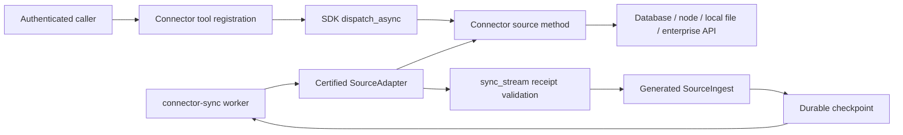

# Implementation design: source sync

1. Define normalized stream/manifest identity and checkpoint invariants in existing manifest and runner types. Keep generated `SourceCheckpoint` as the sole cursor type.
2. Add deterministic drift classification before the sink call and a typed quarantine report. Separate pure classification from I/O so adversarial fixtures run offline.
3. Route every accepted page and deletion reconciliation through generated SourceIngest operations with idempotent retries. Treat uncertain replies as a checkpoint read, not an automatic advance.
4. Port representative enterprise, document/session/feed, and vendor enrichment adapters in small slices using existing SDK ports and presets. Preserve provider license, paging, and rate limits in vendor adapters.
5. Add candidate-repair handoff as a proposal only. Activate only after graph-owned validation, shadow ingest, explicit approval, and restart proof.

Each change carries focused unit/contract tests. A final opt-in integration job runs against a provisioned graph instance and reports exact receipts.

## Ingest worker (SDK-SOURCE-INGEST-R010, R011)

The worker is a thin loop: ask the engine for admission, lane floors and routing, claim, execute with the existing source-effect runners, ack, commit. It owns no scheduling policy, so a change of lane or priority is an engine change only. The command refuses to start when the engine lacks the task-queue methods.

## Paper-provider sources (SDK-SOURCE-INGEST-R005)

Data flow: authenticated connector `tools/call` -> shared paper contract -> provider adapters -> governed HTTP -> normalized results or document receipt.
Ingestion flow: `connector-sync --once` -> certified MCP session -> provider stream -> generated SourceIngest -> accepted checkpoint.

Existing code: `McpToolSourceAdapter.discover` at `agent_connector_sdk/adapters/mcp_tool.py:107` verifies the live schema pin.
Its `extract` at line 118 calls the connector tool and maps records into generated source types.
`ConnectorWorker._sync` at `agent_connector_sdk/runner/worker.py:180` calls the existing sync lifecycle.
The command entry point is `agent_connector_sdk/runner/cli.py:153`.
`fetch_page` at `agent_connector_sdk/adapters/web_fetch.py:86` fetches HTML through governed HTTP and extracts page metadata.
`WebFetchSourceAdapter.extract` at line 182 supplies checkpointed URL pages.
`create_async_http_client` at `agent_connector_sdk/http/client.py:97` supplies transport and TLS policy.

Reachable today: no. The MCP and web-fetch paths are reachable, but no shared paper-provider contract is present.
The web-fetch helper returns normalized HTML or `None`; it does not supply complete binary downloads or typed provider failures.
Reuse HTTP construction, source types, schema certification and sync paging. Do not route paper downloads through HTML text normalization.
Add the shared provider contract and bounded document transfer to the existing adapter package.
Each connector supplies provider-specific search, cursor handling and document offers, then registers the served operations with the SDK.
No paper-serving connector registration is established by this specification; that caller wiring remains required for acceptance.

The `exact_identity` rule groups matching normalized DOI and revision pairs, or explicit canonical aliases supplied by a provider.
Normalize a DOI by removing its URI prefix and case-folding. Preserve the original identifier as provenance.
Otherwise use the provider and its stable record ID; never merge on a similar title alone.
Different known revisions remain distinct. An unknown revision does not establish equality with a known revision.
Sort merged results by canonical identity for replayable output; ranking and semantic equivalence remain outside the SDK.
The `declared_precedence` rule selects nonempty fields by configured provider order, independent of response arrival.
Retain alternate conflicting values and their sources. A missing field remains null unless a document parser extracts it.
The `content_fallback` rule uses deterministic local parsing only for missing fields.
Store parser identity, document digest and page or section location with each extracted value.
A parse failure remains visible and never fabricates metadata or erases a valid provider value.

The `bounded_provider_query` defaults are eight providers, 100 records per provider page and a 60-second request deadline.
An authorized configuration may lower or replace these limits. Continuation binds query digest, provider set and schema version.
A successful provider can return zero records; a failed provider must return a failure report.
At least one successful provider plus a failure yields `partial`; no successful provider yields `failed`.
Use separate provider streams for ingestion so healthy accepted pages do not advance a failed provider's cursor.
Partial search results are never authoritative deletion snapshots. Preserve the existing generated SourceCheckpoint authority in EG.

The `provider_quota` rule requires declared request and concurrency limits before any provider call.
Search, retries and downloads share the provider's credential-scoped quota gate.
Honor provider Retry-After delays; never retry earlier than both the declared quota and provider delay permit.
Default to two read retries within the request deadline. If a delay exceeds that deadline, report `rate_limited` with retry timing.
Quota allocation must cover all concurrent callers sharing those credentials; unavailable shared quota enforcement refuses the provider call.
The SDK enforces supplied limits; it does not choose routing, admission policy or a retry schedule beyond those bounds.

The `complete_document` default caps a document at 50 MiB, with a 30-second transfer deadline.
Stream bounded chunks to a temporary file inside the authorized tenant storage root; do not buffer the entire body.
Recheck destination policy for redirects and refuse traversal, symlink escape or credentials sent to an unapproved host.
Require declared PDF or HTML media, valid content structure and a complete transfer; reject login pages and truncated bodies.
Compare advertised length and checksum when present, compute SHA-256, then atomically install the file under a digest-derived name.
A server without Content-Length is valid only after clean transfer completion and format validation within the byte cap.
Retain the complete original document bytes; metadata extraction must not replace them.
Repeated identical bytes reuse the same tenant-scoped artifact after digest verification.
Changed bytes produce a different receipt and never overwrite an existing digest artifact.
Failure or cancellation removes temporary files and returns a typed reason without a complete artifact reference.
Local artifact storage is authorized source material, not a graph cursor or semantic authority.

Decision: extend R005 and reuse certified MCP source ingestion for provider streams.
Rejected alternative: a separate scholarly search runtime with its own graph store, checkpoint authority and ungoverned downloader.
Cross-repository rows: SDK-SOURCE-INGEST-R001 owns receipt-bound checkpoints; SDK-CONNECTOR-CONTROL-R021 owns declared source access contracts.
Connector packages own provider API bindings. EG's SourceIngest contract owns durable acceptance and graph interpretation.
Arbora supplies authenticated hosting and operator-approved limits. AU consumes results without selecting providers or creating approval policy.
References: no research-paper derivation is claimed for this contract.

## Platform backend fallback (SDK-SOURCE-INGEST-R012)

Data flow: authenticated connector tools/call -> registered handler -> dispatch_async -> shared fallback client -> governed backend HTTP -> typed result.
SDK selects equivalent adapters mechanically under connector policy; it never chooses the user's goal, semantic query or admission policy.
Arbora authentication and authorization remain prerequisites. Connector packages own platform APIs and credential references; EG owns decisions and durable records.
R005.1 through R005.6 aggregate independent paper providers. R012 stops at one valid equivalent backend and does not aggregate their results.

The new closed `PlatformCapability` fields are platform_id, channel_id, operation, schema_revision, policy_revision, required_scope and backends.
Operation is `read` or `search`; separate entries are mandatory when one backend supports only one operation.
Each BackendPolicy contains backend_id, certified adapter identity/version, `enabled`, auth_mode, credential_ref, allowed_destinations, equivalence_contract and quota_group.
Auth_mode is public or credential; only declared public access permits a null credential_ref. Caller scope remains mandatory.
It also contains max_attempts, timeout_ms, retry_policy and output_schema_digest; list order is authoritative.
Equivalence binds the same platform, resource visibility, account scope, query semantics and output contract.
A backend offering only public data cannot replace an authenticated private read or silently narrow its coverage.
Installed software or a reachable port alone does not establish an available capability.

PlatformRequest carries request_id, authenticated tenant/principal/connector binding, platform_id, channel_id, operation, target, query, continuation, limit and deadline.
Exactly target for read or query for search is required. Reject unknown fields and invalid or excessive limits before any backend dispatch.
Continuation, when present, binds tenant, query digest, backend, policy revision and output schema; it cannot migrate to a different backend.
Pin each request's policy snapshot. A concurrent policy update applies to the next request and never changes an in-flight chain.
PlatformResult contains request_id, request_digest, outcome, reason, records, continuation, selected_backend, attempts, skipped_backends, channel_status and provenance.
Outcome is `ok` or `refused`; a refusal has a required reason, no records and no successful continuation.
Attempt fields are sequence, backend_id, attempt_number, outcome, reason, started_at, elapsed_ms, retry_after_ms and response_digest.
Transient reasons are `connection_failed`, `timeout` and `upstream_unavailable`.
Terminal reasons are `rate_limited`, `unauthorized`, `egress_denied`, `trust_failed`, `invalid_response`, `not_found` and `cancelled`.
Success has a null reason. HTTP status is optional numeric evidence; omit raw error bodies.
An attempt outcome is `ok`, `failed` or `cancelled`; record one entry per actual outbound attempt, including lower-level retries.
Skipped backend configuration is reported separately with a reason; it must never appear as an attempted network call.
Selected_backend is the successful backend, or null on refusal. No cached success may be presented as the current request's backend.

The `ordered_equivalent_fallback` rule starts with the first eligible backend and preserves list order.
Eligibility requires declared capability, active configuration, certification, the declared authentication mode, matching authority and an approved destination.
An empty eligible list returns no_backend; an unknown platform or operation returns unsupported_capability without network activity.
Request-level authorization failure returns unauthorized before selecting any backend.
Missing backend configuration is visible, but missing or denied caller authority cannot be bypassed by selecting another backend.
Default bounds are four backends, two attempts per backend, eight total attempts, ten seconds per attempt and thirty seconds overall.
Default result bounds are 100 records and one MiB of response bytes; an admitted configuration may lower these ceilings.
Validate every configured bound. The outer remaining deadline limits connect, transfer, parsing, quota waiting, backoff and all retries.
Use the existing RetryPolicy for idempotent reads; pass its actual attempts into the outer budget rather than nesting hidden retries.
Only transport connection failures, timeouts and HTTP 408 or 5xx permit the next declared equivalent backend.
HTTP 429 honors Retry-After within the remaining budget; exhausted waiting returns rate_limited and does not switch credentials or quota groups.
HTTP 401/403, egress denial, certificate failure, malformed output and authoritative not-found stop the chain with the matching typed refusal.
An empty, valid search response is success. Empty required read content is invalid_response, not a synthetic successful document.
If all attempted eligible backends fail transiently, return chain_exhausted with their complete ordered history.
Deadline expiry returns deadline_exceeded; cancellation stops outstanding work and forbids subsequent backend attempts.
No fallback crosses into write operations, login automation, browser interaction or native device effects.

ChannelStatus contains platform_id, channel_id, operation, policy_revision, selected_backend, health, backend_states, observed_at and expires_at.
Health is unknown before observation, healthy for first-choice success, degraded for fallback success, and unavailable for observed total failure.
Each backend state distinguishes untested, disabled, unconfigured, healthy and failed, with its latest safe reason and observation time.
Caller refusals do not change backend health; only authorized observations do.
Status snapshots are scoped by tenant, connector, account authority and capability; they never authorize a later request.
The default status lifetime is sixty seconds. Expired observations become unknown and expose the previous timestamp without claiming current health.
The registered status action returns these observations without probing or changing configuration; active probes require a separately admitted read.
Status must derive from actual calls or declared probes. Preserve unsupported entries rather than implying uniform platform support.
Read results retain source identity, backend, retrieval time, content digest and declared coverage alongside each returned record.
An identical read retry retains request identity but may observe changed content. It guarantees neither durable effects nor unchanged content.
Existing SourceIngest owns accepted records and checkpoints. A refused read must not be mapped to an empty accepted page or deletion snapshot.

Production call sites: register_tool_surface at mcp/tool_surface.py:121 installs connector registrars; it does not itself implement fallback.
`dispatch_async` at `agent_connector_sdk/mcp/action_dispatch.py:194` invokes the resolved method through `invoke_client_method`. It currently returns that method's result.
McpToolSourceAdapter.extract at adapters/mcp_tool.py:118 receives session.call_tool results at line 131 before record mapping.
Its pinned tool schema and raw-record mapping must preserve successful records and reject a PlatformResult refusal before page construction.
ConnectorWorker._sync at runner/worker.py:180 remains the ingestion caller; no new runner or checkpoint store is needed.
`fetch_page` at `agent_connector_sdk/adapters/web_fetch.py:86` is a governed read backend. It collapses HTTP and empty-content failures to None.
Extend that adapter boundary with typed outcomes rather than guessing a reason from None or duplicating its HTTP implementation.
Reuse `create_async_http_client` at `agent_connector_sdk/http/client.py:97` for HTTP. Compose `RetryPolicy` at `agent_connector_sdk/http/retry.py:71` for retries.
Add shared platform models and fallback composition under `agent_connector_sdk/adapters`. Register connector-owned read/search/status methods through existing registrars.
The authenticated MCP client receives PlatformResult; the source adapter consumes it only after success and schema validation.
Reachable today: generic dispatch and one web reader exist. Platform inventory, equivalent-backend fallback, status composition and refusal mapping are missing.
All R012 rows require actual connector registration and served acceptance.

Decision: reuse the SDK dispatcher, governed HTTP, certification and SourceAdapter boundary.
Rejected alternative: a separate routing service that selects semantic actions or introduces another health authority and ingestion store.
Operational status is bounded observation; it is neither EG knowledge nor an authorization decision.
References: the source motivates ordered per-channel backends and observed status; no arXiv derivation is claimed.

## Source contract extension design

The six contracts extend R001, R004, R005 and R006 without replacing any original acceptance.
Each six-child sequence orders Model, Behavior, Wiring, Refusal, Evidence and Hot-path proof.
Implementations and served acceptance for these extensions are absent. Existing receipts establish only their original scopes.
No new durable store, semantic planner, authorization service or scheduler is introduced.

### Shared production attachments and authority

Component: Source ingestion
Depends-on: SDK-GOVERNED-WRITEBACK-R001, SDK-CONNECTOR-CONTROL-R021
Depends-on: [Source ingestion authority](https://github.com/Knuckles-Team/epistemic-graph/blob/fe6982b29d0b60ad2a10092c959c238eeb74e919/specs/repository-index-and-ingestion/requirements.md)
Depends-on: [Approved query execution](https://github.com/Knuckles-Team/epistemic-graph/blob/fe6982b29d0b60ad2a10092c959c238eeb74e919/specs/federated-query-and-reasoning/requirements.md)
Code: `../../agent_connector_sdk/runner/worker.py:150` `../../agent_connector_sdk/runner/syncing.py:200`
Code: `../../agent_connector_sdk/mcp/action_dispatch.py:194` `../../agent_connector_sdk/ports/source_adapter.py:21`

Data flow: connector tools/call -> register_tool_surface -> dispatch_async -> connector-owned source method -> typed adapter -> generated ingestion.
The ingestion entry is connector-sync --once at `agent_connector_sdk/runner/cli.py:153`.
ConnectorWorker._sync at `agent_connector_sdk/runner/worker.py:180` calls sync_stream at `agent_connector_sdk/runner/syncing.py:200`.
sync_stream reads source_status before extraction and submits each page through commit_page at line 106.
EpistemicGraphSink at `agent_connector_sdk/sinks/epistemic_graph.py:91` bridges the generated source contract.
SourceAdapter at `agent_connector_sdk/ports/source_adapter.py:21` remains the common discovery, extraction and reconciliation interface.
Connector registrars attach tools through `agent_connector_sdk/mcp/tool_surface.py:121`.
Their handlers use dispatch_async at `agent_connector_sdk/mcp/action_dispatch.py:194`.
McpToolSourceAdapter.extract at `agent_connector_sdk/adapters/mcp_tool.py:118` calls the source tool before mapping records.
The implementations must preserve typed refusals across that boundary instead of mapping them into empty successful pages.
Arbora offers authenticated hosting and admission. AU consumes typed results and runs received harness calls.
EG alone owns durable checkpoints, graph interpretation, ontology and semantic query decisions.

Dependencies:
- R001.3 depends on R001.1 and R001.2; R001.6 requires R001.3 through R001.5.
- R004.3 depends on R004.1 and R004.2; R004.6 requires R004.3 through R004.5.
- R005.9 depends on R005.7 and R005.8; R005.12 requires R005.9 through R005.11.
- R005.15 depends on R005.13 and R005.14; R005.18 requires R005.15 through R005.17.
- R005.21 depends on R005.19 and R005.20; R005.24 requires R005.21 through R005.23.
- R006.34 depends on R006.32 and R006.33; R006.37 requires R006.34 through R006.36.

Cross-repository rows:
- [EG-REPO-INGEST-R002](https://github.com/Knuckles-Team/epistemic-graph/blob/main/specs/repository-index-and-ingestion/requirements.md) owns generated SourceIngest authority.
- [EG-FEDERATED-QUERY-R015](https://github.com/Knuckles-Team/epistemic-graph/blob/main/specs/federated-query-and-reasoning/requirements.md) owns read-only SQL enforcement.
- [EG-FEDERATED-QUERY-R043](https://github.com/Knuckles-Team/epistemic-graph/blob/main/specs/federated-query-and-reasoning/requirements.md) owns outbound SQL connection admission.
- [EG-FEDERATED-QUERY-R069](https://github.com/Knuckles-Team/epistemic-graph/blob/main/specs/federated-query-and-reasoning/requirements.md) owns semantic SQL pushdown and shared rendering.
- [SDK-GOVERNED-WRITEBACK-R001](../SDK-GOVERNED-WRITEBACK/requirements.md) owns the governed write-back transport prerequisite for enterprise effects.
- [SDK-CONNECTOR-CONTROL-R021](../SDK-CONNECTOR-CONTROL/requirements.md) owns declared source access contracts.

These are prerequisites, not proof that the consuming source methods are implemented.
The SQL connector consumes an approved query operation; an absent generated producer binding must remain an explicit implementation blocker.
Related references: R012 covers alternative read backends, not common enterprise operations.
R005.1 through R005.6 cover independent paper providers, not these local-file formats or transaction logs.
R006.1 through R006.31 retain vendor extraction acceptance; normalized read extraction alone cannot satisfy enterprise effects.
Concurrency values come from admitted configuration. SDK enforces them without choosing scheduling policy.

### Concurrent stage resume: R001.1 through R001.6

Existing code: ConnectorSyncRunner.run_once at `agent_connector_sdk/runner/supervisor.py:62` already runs separate connectors concurrently.
ConnectorWorker._cycle at `agent_connector_sdk/runner/worker.py:150` still runs one connector's presets sequentially.
sync_stream at `agent_connector_sdk/runner/syncing.py:200` already reads the accepted durable checkpoint for each stream.
Reachable today: no. Concurrent connector cycles exist; independently resumable concurrent stages within a source remain missing.

StageDescriptor fields are stage_id, tenant, connector, source, stream, manifest_digest, dependencies and admitted_limits.
Dependencies name stage identities and required receipt identities; a validated acyclic graph fixes their order.
Limits contain positive maximum active stages, page rows, page bytes, queued pages and a deadline.
Missing limits refuse before scheduling. Tests use two active stages and a single queued page per stream.
StageResult contains stage_id, outcome, previous_checkpoint, offered_checkpoint, accepted_receipt, dependency_receipts and reason.
Outcomes are complete, failed, blocked or cancelled; failed and blocked stages never acquire another stage's success receipt.
Different stages use distinct generated stream identities. They cannot share a mutable progress token or local checkpoint file.
The runner obtains a fresh source_status for each stage at process start and after ambiguous commit responses.
Extraction requests events strictly newer than the accepted progress token; equal-boundary events are never new events.
Retries may redeliver an unacknowledged page with the same idempotency key; durable acceptance must remain exactly once.
A cancelled stage closes its source session after observing any in-flight commit outcome through durable readback.
Successful independent stages retain their receipts when a sibling fails. Dependent stages remain blocked until prerequisites commit.
The aggregate run remains incomplete while any required stage fails, blocks or cancels.
Decision: extend the worker preset loop and retain sync_stream's receipt validation.
Rejected alternative: a second pipeline engine with local stage progress tokens or new scheduling policy.

### Native SQL transport: R004.1 through R004.6

Existing code: SourceAdapter, McpToolSourceAdapter and sync_stream implement paging and durable acceptance.
Searches for SQL, fetchmany and database execution found no native SQL driver path in the SDK adapter package.
Reachable today: no. Generated source submission does not generate or execute database queries.

DatabaseRequest fields are request_id, tenant, principal, source, operation_digest, dialect, parameters, snapshot_id and limits.
Input is an engine-approved relational operation or an approved parameterized statement, never an unconstrained natural-language instruction.
The connector renders only admitted operation structure into its declared database dialect and binds parameters through the driver.
Identifiers require the approved schema mapping; parameter binding cannot substitute for identifier validation.
The connector does not change semantic predicates, authorization scope, selected source or query planning.
An unsupported operation or dialect refuses; SDK must not replace the missing engine producer with local inference.
Chunk fields are query_id, snapshot_id, sequence, typed_columns, rows, row_count, byte_count and continuation.
TerminalResult fields are query_id, outcome, total_rows, total_bytes, last_sequence and reason.
Only complete completes successfully. A disconnected stream without TerminalResult remains incomplete.
Every continuation binds authority, schema, query digest and snapshot. Snapshot changes require a typed refusal.
The approved read-only driver session enforces no DDL, DML or multiple-statement escape.
Driver progress tokens use bounded fetches, bounded queues and downstream backpressure; no fetch-all or hidden result accumulation.
Test limits are 256 rows, one MiB per chunk and two queued chunks; production uses validated admitted bounds.
Cancellation and any driver failure close the database handle, stop fetching and produce a visible typed terminal failure.
Already accepted pages remain visible receipts; failure never retroactively labels the overall query complete.
A failed page advances no checkpoint, and an ambiguous accepted page requires durable readback before retry.
Decision: reuse the source adapter and generated ingestion path with native driver streaming.
Rejected alternative: treating graph submission as SQL execution or returning a successful list after truncating an errored stream.

### Offline bookmark JSON: R005.7 through R005.12

Existing code: `agent_connector_sdk/vendor_extractors/social.py:160` extracts hashtags, mentions and known tools from structured records.
Its URL helper at line 143 reads embedded URL fields; its domain helper at line 82 performs local hostname parsing.
The extractor returns an empty ChangeSet for missing record identity; the new adapter must visibly refuse that malformed input.
Reachable today: no. Local helpers exist; bookmark-file discovery, pagination and domain-category output remain absent.

BookmarkRequest binds root authority, relative_path, file_digest, export_revision, mapping_revision and limits.
BookmarkRecord fields include bookmark_id, source_text, hashtags, urls, tool_mentions, domain_category and provenance.
The supported export profile declares JSON array or bounded item-stream structure and required identity/text/entity fields.
Unsupported export versions refuse. A changed file digest invalidates a continuation rather than merging different snapshots.
A versioned local vocabulary maps exact tool names and hostnames; domain categories describe that mapping, not inferred graph knowledge.
Unknown mappings emit null category and preserve the hostname. No semantic classification or model call fills missing values.
URL normalization preserves original bytes and source locations; normalization never triggers DNS, HTTP, previews or link expansion.
Stable record keys bind source export identity and bookmark ID; identical content reimport creates no duplicate accepted record.
Limits bound file bytes, per-record bytes and records per page. Fixtures use two records per page and a one-MiB file cap.
Malformed records report record location and typed reason; the page remains unaccepted until corrected.
Decision: wrap the existing deterministic extractor and add missing file/schema/category handling.
Rejected alternative: a network enrichment service or duplicate metadata extractor.

### JSON-RPC chain logs: R005.13 through R005.18

Existing code: EventFeedSourceAdapter.extract at `agent_connector_sdk/adapters/event_feed.py:133` reads tool pages and validates event envelopes.
Reachable today: no. Envelope validation does not decode node transaction logs or establish a registered JSON-RPC node method.
Reuse create_async_http_client at `agent_connector_sdk/http/client.py:97` for governed transport.
Connector packages own chain-specific event schemas and node calls; the SDK owns the typed extraction and refusal contract.

ChainLogRequest binds chain_id, contract_id, event_signature, decoder_revision, from_block, to_block, authority and limits.
TradeRecord binds block_number, block_hash, transaction_hash, log_index, asset_ids, integer_amounts, scales, side and timestamp.
The declared decoder fixes amount units and side mapping. Unknown layouts, signatures or scales refuse before typed records exist.
Cursor order is block number, transaction position and log index, pinned to chain and decoder revision.
The source marks the queried range complete only after every returned log validates and the page receives durable acceptance.
Duplicate transport delivery uses stable event IDs; neither response arrival order nor float conversion changes identity or values.
Tests cap JSON-RPC requests at ten blocks and 100 events; admitted production limits may differ.
RPC errors, malformed bodies and undecodable logs return typed source failures rather than empty successful pages.
Inconsistent block hashes refuse and preserve the accepted progress token for engine-owned reconciliation.
No trade from a rejected page enters durable storage; rejected-event reports retain identity, digest and reason.
Decision: attach a node decoder to the existing certified event-feed path.
Rejected alternative: treating generic event envelopes or finance reads as proof of chain decoding.

### Workspace format reads: R005.19 through R005.24

Existing code: McpToolSourceAdapter.extract and the worker offer tool calls and typed source-page acceptance.
WebFetchSourceAdapter at `agent_connector_sdk/adapters/web_fetch.py:182` handles URL pages, not these local binary formats.
Searches for document, transcript and PDF found no bounded parallel workspace reader in the adapter package.
Reachable today: no. The declared format reader and concrete connector registration are missing.

WorkspaceReadRequest binds tenant, root authority, relative_paths, format_profile, parser_versions and limits.
FileOutcome binds path identity, digest, format, parser revision, locations, content, outcome and reason.
The profile supports PDF, DOCX, XLSX, UTF-8 plain text and UTF-8 transcript profiles including VTT and SRT.
Legacy binary office formats require separate declared support; absence returns unsupported_type rather than guessed text.
Document locations use page and paragraph; spreadsheets use sheet and cell coordinates; transcripts retain cue timestamps.
Plain text retains line offsets. A file without requested content reports absence without inventing text.
The request captures an immutable manifest of path, size and digest; changed files refuse rather than mixing snapshots.
Enforce the resolved authorized root at open time. Symlink escapes and parent traversal refuse without reading outside it.
Parsers process local bytes only and cannot execute macros or follow external relationships.
Compressed office formats require a decompressed-byte bound; compressed size alone cannot prevent memory exhaustion.
Tests use two concurrent files, ten-MiB per file, 100 pages and a 30-second deadline.
A file failure yields an explicit per-file outcome; mixed results remain partial, with no fabricated successful content.
Each file uses its own generated source stream for ingestion so one failure cannot advance another file's progress token.
The result order follows the request's normalized path list while runtime traces prove actual overlapping reads.
Decision: reuse dispatch and source ingestion with bounded local parsers.
Rejected alternative: AU-owned source schemas, a duplicate progress token store or sequential execution labelled as parallel.

### Enterprise operation interchange: R006.32 through R006.37

Existing code: `agent_connector_sdk/vendor_extractors/odoo.py:74` and `agent_connector_sdk/vendor_extractors/erpnext.py:91` normalize read extraction.
Reachable today: no. These readers do not expose one interchangeable enterprise operation port or its served methods.
Reuse vendor extraction types, certified registration and the governed write-back port; keep backend APIs in separate connectors.

EnterpriseOperation binds request_id, tenant, company_id, contract_revision, operation, typed_parameters and authority.
EnterpriseCapability binds connector identity/version, company scope, supported operations and input/output schema digests.
EnterpriseResult binds request_id, connector identity, operation, contract_revision, outcome, records, effect_receipt and typed reason.
Read-only calls return typed records; effecting calls require the existing generated approved change-set and governed effect receipt.
No local approval token or replacement write-back DTO is introduced.
The initial conformance operations are list_accounts, read_invoice and create_invoice; supported subsets are declared per connector.
Normalized account fields are source_id, account_code, label, account_kind and currency.
Invoice fields are source_id, company_id, counterparty_id, currency, amount_minor, scale, status and issued_at.
Adapters preserve exact amounts and timezone-bearing timestamps; incompatible field semantics return schema_mismatch.
Unsupported operations return unsupported_operation before driver or HTTP calls. They never trigger fallback to another connector.
Backend choice comes from the caller's approved configuration. The workflow uses the same contract before and after that choice changes.
A create_invoice request enters governed write-back with approval, optimistic precondition and idempotency evidence.
A read method cannot execute effects or synthesize an effect receipt from accepted graph ingestion.
Decision: add a common operation boundary and adapt existing backend readers.
Rejected alternative: claiming interchangeability from matching extractor output or provider-profile selection alone.

### Acceptance evidence

Each Hot-path proof row names its planned integration test. Those tests and runtime receipts do not exist for these complete contracts.
Use actual connector registration and wire dispatch, real local SQL/HTTP services, on-disk format fixtures and a running graph.
The graph service may be test-provisioned; mocks of ingestion or dispatcher calls cannot prove durable acceptance.
Record exact source revision, commands, registration, request traces, resource measurements and redacted generated receipts.
Keep unsupported operations, malformed records, interrupted streams and failed stages visible through the same receiving client.
Definition gates and existing helper tests do not close these acceptance rows.
References: no research-paper derivation is claimed for these six contracts.

## Approved query receiving contract: R004.7 through R004.12

These children refine R004.1 through R004.6 without replacing their acceptance or prior receipts.
EG-FEDERATED-QUERY-R085.1 through R085.8 owns the producer records, authorization, digest rules and immutable approval lifecycle.
The SDK imports those generated records rather than declaring parallel wire models.
The producer and receiver implementations remain absent; definition agreement does not establish runtime delivery.

### Exact receiving methods

The planned class is `SqlQuerySourceClient` in `agent_connector_sdk/adapters/sql_source.py`.
Its asynchronous execute_approved_query(approved_query: `ApprovedSourceQuery`, continuation: `SqlQueryContinuation` | None = None) returns `SqlQueryPage`.
Its asynchronous cancel_approved_query(approved_query: `ApprovedSourceQuery`, continuation: `SqlQueryContinuation`) returns a terminal `SqlQueryPage`.
An active execution returns failed with reason cancelled; a finished execution returns its recorded terminal outcome.
Authenticated context, generated EG client and certified source driver enter through server composition, never caller-entered identity fields.
Each call returns one bounded page. Neither the dispatcher nor receiving client collects the complete result.
Continuation is absent only for a new execution; a present continuation resumes that execution or returns an explicit failure.
The methods retain exact approved SQL bytes and parameter types, positions and values.
For this generated variant, EG has already rendered SQL; SDK rendering means native parameter binding only.

Producer operations:
- `ApproveSourceQuery` { request: SourceQueryRequest } -> `ApprovedSourceQuery`.
- `VerifySourceQueryApproval` { request: `SourceQueryApprovalCheck` } -> `SourceQueryApprovalValidity`.

### Imported producer fields

- `SourceQueryRequest { schema_version, source_ref, source_revision, schema_digest, snapshot_ref, dialect, sql, parameters, limits, requested_expires_at_ms, idempotency_key }` requests one read-only SQL operation.
- `SourceQueryLimits { max_rows, max_bytes, chunk_rows, chunk_bytes, queue_depth, queue_bytes, deadline_ms, max_resident_bytes }` has finite positive integer fields. Row/byte fields count decoded data and encoded payload within their respective declared budgets. Deadline time uses the server's authoritative milliseconds.
- `SourceQueryParameter { position, kind, value }` uses closed kinds `null`, `bool`, `int64`, `float64`, `text`, `bytes`. Positions and placeholder counts must match. Values must fit the declared type and dialect; nonfinite floats refuse. No string interpolation substitutes for native parameter binding.
- `ApprovedSourceQuery { schema_version, approval_id, query_id, request, tenant_ref, owner_ref, actor_ref, authority_digest, policy_digest, identity_digest, allowed_operations, issued_at_ms, expires_at_ms, hard_expires_at_ms, operation_digest, parameter_digest, query_digest }` is immutable. `allowed_operations` is exactly `[read_sql]` for this version.
- `SourceQueryApprovalCheck { approved_query, observed_source_revision, observed_schema_digest, observed_snapshot_ref, phase }` uses phases `start`, `chunk`, `complete`.
- `SourceQueryApprovalValidity { approval_id, query_id, query_digest, lease_revision, checked_at_ms, valid_until_ms }` is a bounded validation result. It does not replace the next required validation or authorize another descriptor.

The imported SourceQueryLimits fields remain finite positive integers. SDK must not increase any bound.
The SDK must not compute a replacement approval digest or interpret a copied control-lease view as authorization.
EG owns Digest256::framed under eg/source-query-approval/v1 and reserved lease kind source.query.approval.
The SDK never invokes generic `IssueControlLease` to mint or renew this approval.
A descriptor, handle, local cache or prior successful validation cannot replace a fresh authoritative validation.

### Local delivery envelope

`SqlQueryContinuation` binds execution_id, query_id, approval_id, query_digest, next_sequence and source/schema/snapshot identities.
The connector stores only bounded ephemeral driver execution state under the authenticated tenant, owner and actor or verified delegation.
Continuation contains an opaque handle, not credentials or an approval grant. A handle cannot transfer execution to another authority.
Lost or unknown handles return query_failed with an incomplete execution identity; they never silently restart the database query.

`SqlQueryPage` contains outcome, query_id, approval_id, query_digest, execution_id, sequence, source_ref, source_revision and schema_digest.
It also contains snapshot_ref, typed_columns, rows, page_rows, page_bytes, total_rows, total_bytes, continuation, verification and error.
Outcome is chunk, complete or failed. All fields use the approved schema version and immutable source bindings.
A chunk has bounded rows and continuation, no error, and the fresh phase-chunk verification receipt.
A complete page has no rows or continuation and includes the fresh phase-complete receipt and final totals.
A failed page has no rows or continuation. Its error includes the generated reason, stage and last completed chunk.
The failed envelope includes no successful verification when the current validation failed.
Sequence increases once per published chunk. Total rows and bytes count all published decoded content and encoded payload budgets.
Exactly one complete or failed terminal page ends execution. Missing terminal output never means successful completion.

### Verification, bounded execution and effects

Before driver creation, observe source registration, revision, schema digest and real snapshot identity through the certified connector.
Send the full approved descriptor and those observed facts in `SourceQueryApprovalCheck` with phase start.
Use the existing authenticated EG client; caller-entered tenant, actor or lease fields cannot mint authority.
Match returned approval_id, query_id and query_digest to the request. Retain lease_revision and server timestamps as evidence.
Only an active approved read_sql descriptor permits a database-enforced read-only transaction.
Unsupported dialects, unknown SQL effects, wrong snapshot or unavailable read-only driver enforcement refuse before execution.
SDK does not alter semantic predicates, add a LIMIT, interpolate parameters or choose another source.
Pass native typed parameters to the driver exactly; reject unrepresentable values without lossy coercion.

Use bounded native fetches and queues with row, byte, queue-depth, queue-byte, deadline and resident-memory limits.
An oversized single row fails; it cannot be truncated or exempted from the budget.
Backpressure stops fetching while a prior page awaits the consumer.
Reobserve source/schema/snapshot bindings and call phase chunk before publishing each chunk.
If validity expires while waiting to publish, repeat the validation or refuse. Stale validation cannot authorize delayed output.
Call phase complete before publishing successful terminal completion.
Any failed revalidation stops fetching, discards unpublished rows and closes the database handle.
SDK enforces deadline_ms through a monotonic elapsed budget derived from authoritative verification timestamps.
Each verification RPC must finish within that remaining deadline. Record its latency and the total verification call count.
An execution watchdog closes abandoned handles at the admitted deadline, even when the client requests no further page.
The local wall clock cannot extend expires_at_ms, hard_expires_at_ms, valid_until_ms or the approved deadline.

Closed error reasons are unsupported_dialect, invalid_query, unauthorized, approval_expired, approval_revoked and stale_source.
They also include query_failed, limit_exceeded, cancelled and verification_unavailable.
Preserve the producer reason when verification fails. Transport loss produces verification_unavailable rather than inferred authority.
Cancellation closes the bound local handle without needing new read authority; it never cancels another caller's execution.
The connector retains bounded terminal metadata until the execution deadline.
Repeated cancellation returns that outcome without another database effect or terminal event.
Cancellation cannot replace an existing successful completion with failure.
Failure after three published chunks remains failure with an incomplete identity and no successful terminal event.

### Production attachment and checkpoint consumption

Existing code: register_tool_surface at `agent_connector_sdk/mcp/tool_surface.py:121` installs connector registrars.
dispatch_async at `agent_connector_sdk/mcp/action_dispatch.py:194` invokes their asynchronous client methods.
McpToolSourceAdapter.extract at `agent_connector_sdk/adapters/mcp_tool.py:118` calls the registered tool and maps its result.
ConnectorWorker._sync at `agent_connector_sdk/runner/worker.py:180` calls sync_stream at `agent_connector_sdk/runner/syncing.py:200`.
commit_page at `agent_connector_sdk/runner/syncing.py:106` remains the generated SourceIngest commit path.
Reachable today: no. Approval-aware SQL methods, the page bridge and the generated EG approval operations are not implemented.

The adapter bridge must distinguish chunk, complete and failed pages before constructing any RecordPage.
Only a valid chunk may enter generated ingestion. Completion conveys exhaustion without pretending an empty failure was accepted.
A failed envelope never becomes an empty authoritative snapshot or a deletion instruction.
If completion verification fails after accepted chunks, retain their actual receipts and report the query as incomplete.
No failed or unpublished chunk advances the durable SourceCheckpoint.
After restart, read durable accepted state before replay. Never use a stale local continuation as checkpoint authority.
A lost execution requires explicit new execution against the same verified snapshot and stable record identities.
Retain accepted-page receipts and duplicate protection; do not claim resumable driver state survives process loss.

Depends-on: SDK-CONNECTOR-CONTROL-R021
Depends-on: [EG-FEDERATED-QUERY-R085](https://github.com/Knuckles-Team/epistemic-graph/blob/c67bad3d6326da3b7c161c21fbd6cf78fec4cc6d/specs/federated-query-and-reasoning/requirements.md)
Producer prerequisite: EG-FEDERATED-QUERY-R085.1 through R085.8.
Within R004, .8 depends on .7; .9 binds both into production; .12 requires .7 through .11.
Decision: reuse authenticated dispatch, generated verification, native parameter binding and the existing ingestion bridge.
Rejected alternative: a local approval cache, copied lease authority, semantic SQL renderer or materialized whole-result response.

### Required integration evidence

The served journey must invoke actual `ApproveSourceQuery` and `VerifySourceQueryApproval` methods through authenticated EG dispatch.
Send the resulting generated descriptor through the registered SDK tools/call receiver to a real local database.
Use the same descriptor for subsequent pages; observe phase start, each phase chunk and phase complete.
Change each binding individually and prove refusal. Revoke between chunks and require driver closure before the next publication.
Inject failure after three chunks, cancel with queued rows, lose verification transport and expire authority during backpressure.
Observe zero unauthorized database starts, no unapproved chunks and no successful terminal event on failure.
Read accepted records and checkpoints through the generated graph client.
Retain R004.6's fixed-limit memory experiment across a hundredfold increase in rows.
Record exact EG/SDK revisions, generated schema revision, commands, driver requests, verification receipts and peak memory.
No runtime execution evidence is established by this definition slice.

<!-- spec-definition-patch:webui-3-10-source-definition-20261012 -->
## Supported-harness session discovery (R013)

**Ownership.** SDK owns discovery, synchronization, and SourceIngest receipts. EG owns indexing and queries. Arbora owns served reads. WEBUI-APPS-R006.4 consumes the browser response.

**Attachment.** Reuse connector-sync --once and its existing worker. Reuse McpToolSourceAdapter.extract and the generated SourceIngest client. Add no parallel runner or UI-local index.

Owners must publish the complete supported-harness manifest. Each entry names a real repository, operation, revision, authority, identity schema, and cursor form. Do not infer entries from examples.

Bind source identity to tenant, harness, and session. Bind replay to source revision and cursor. Advance only after an accepted receipt. Preserve denied, failed, and partial outcomes through restart.

HS-13.6 exercises served discovery for every approved entry. It reads generated receipts and the durable EG index. It exercises WEBUI-APPS-R006.4. A denied source stays partial. Other sources continue. Cross-tenant reads refuse.

EG and Arbora owners must publish exact counterpart IDs before implementation. This SDK packet does not invent them.

## Scheduled paper sourcing (SDK-SOURCE-INGEST-R005.25 through R005.30)

Scheduled job cycles at six-hour boundaries with owned paper proposals. Each cycle fetches relevance scores from EG producer against platform and graph goals. Selection applies per-goal admission thresholds. Accepted papers link their ingestion receipts to the job run before committing. Durable job clock and run identity support deduplication and restart.

The scheduled job is distinct from R005.1-R005.6 paper provider search; this contract covers job-owned cycling and admission gates.

EG owns relevance producer and admission decision. SDK claims jobs, applies selection and produces durable receipts.

## Citation-edge paper extraction (SDK-SOURCE-INGEST-R005.31 through R005.36)

Paper records carry source-attributed metadata and native citation-edge declarations. Extraction edges enter EG assertion directly. Per-paper metadata-extraction refusal preserves healthy papers. Unidentified-paper identity allows missing metadata when documents are unavailable.

Distinct from R005.1-R005.6 basic provider contract; this segment covers citation graph construction and per-paper failure handling.

SDK transports facts; EG asserts edges and resolves semantics.

## Incremental repository indexing (SDK-SOURCE-INGEST-R004.13 through R004.18)

Delta indexing computes indexes only for changed files within declarative memory and completion bounds. Semantic type resolution binds language matrix and optional analysis mode. Peak memory prevents unbounded growth; resource release completes all in-memory structures after indexing.

This extends R004.1-R004.6 SQL execution with incremental content indexing and type semantics.

SDK enforces bounds; EG owns type authority and semantic interpretation.

## Paper throughput and purge policy (SDK-SOURCE-INGEST-R015)

EG measures observed paper ingestion throughput (papers per window) and decides maintenance when below target. Purge authorization binds goal identity, safe-purge policy and candidate set. SDK applies authorization and durable deletion before checkpoint advance. Below-threshold status is visible with distinct reason.

New rollup distinct from R005 source contracts.

EG owns decision; SDK enforces observation and authorized maintenance.

## Media vision enrichment (SDK-SOURCE-INGEST-R016)

Designated vision producer infers object and context tags from bounded image/thumbnail input. Tags attach to media records with model and source provenance. Unauthorized or fabricated tags refuse before ingestion. Identical media with the same producer returns stable tag set.

New rollup for media modality enrichment.

Producer owns inference; SDK transports and attaches results through EG authorization.

## Live meeting and summary transport (R014)

**Ownership.** SDK owns transport and receipt linkage. Audio-transcriber owns transcribe_audio. EG owns transcript/context authority. Arbora owns authorized operations. WebUI owns capture and display through WEBUI-APPS-R001.5.

The current WebUI route posts to /api/enhanced/voice/transcribe after MediaRecorder stops. Audio-transcriber registers transcribe_audio for a file or microphone capture. Both are single-shot paths. Neither proves live segments or summaries.

Keep existing dictation. Owners must identify a real meeting operation and local/hosted summary operations before implementation. Do not invent registrations.

Carry meeting and tenant identity, segment and sequence, correction revision, source time, lifecycle, and provenance. Accept bounded ordered partial ingestion. Exact bound replays return the existing receipt without a second effect. Refuse conflicting duplicates and stale updates. Corrections advance one segment revision and invalidate older summaries. Gaps may remain pending while partial and block finalization until filled. Permit finalization once the current sequence is complete and contiguous, and bind its receipt to that transcript revision. Summary dispatch requires that exact finalized receipt.

Honor the user's admitted provider choice. Refuse denied capture, denied egress, and unavailable providers before effects. Never switch from local to hosted silently.

Acceptance enters real SDK dispatch. It observes ordered partials, exact replay, conflicting-duplicate refusal, and correction. It proves zero summary calls before complete-sequence finalization. It then exercises local and hosted providers separately. It reads durable provenance and confirms denied requests cause no provider call.

EG and Arbora owners supply their operation IDs. No runtime work is authorized in this definition slice.
<!-- /spec-definition-patch -->

## Ingest under an accepted contract (R017)

The runner ingests only under the contract revision that the engine accepted (`EG-TYPED-PACKS-R101`). Call path: sync runner → `ingest_documents` (`agent_connector_sdk/adapters/document_sources.py:402`) → `submit` (`agent_connector_sdk/ingest/service.py:74`) → accepted-contract digest comparison → entity request creation (`agent_connector_sdk/ingest/request.py:85`) → engine `SourceIngest`. Nested source values become declared entities and relationships, not nested properties. The pack is generated from the connector's typed declaration (`SDK-CONNECTOR-CONTROL-R067`).
